<div align="center">


# Visualify

### Turn study topics, PDFs, and handwritten notes into editable visual diagrams and interactive study kits.

Describe a concept, select PDF page ranges, or upload a photo — Visualify plans structured visual sections, compiles editable **Excalidraw** scenes, and builds synced quizzes, flashcards, revision sheets, and note Q&A.

<p>
  
  
  
  
  
  
</p>

[**Tour**](#-product-tour) · [**Architecture**](#-architecture) · [**Quick Start**](#-quick-start) · [**Environment**](#-environment-variables) · [**Design System**](docs/design/DESIGN.md) · [**Deployment**](#-deployment--security)

</div>

---

## ✨ Product Tour

<picture>
  <source media="(prefers-color-scheme: dark)" srcset="docs/assets/hero-dark.png" />
  <source media="(prefers-color-scheme: light)" srcset="docs/assets/hero-light.png" />
  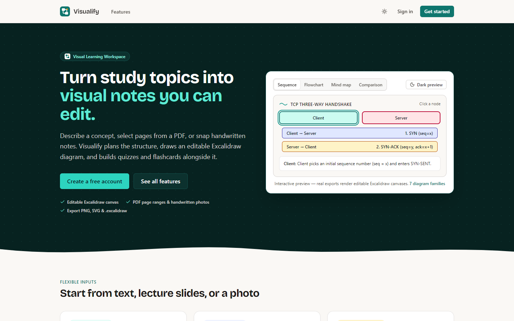
</picture>

| Interactive Excalidraw Workspace (Dark) | Active Recall Study Kit (Light) | Multi-Frame Present Mode (Dark) |
| :--- | :--- | :--- |
| 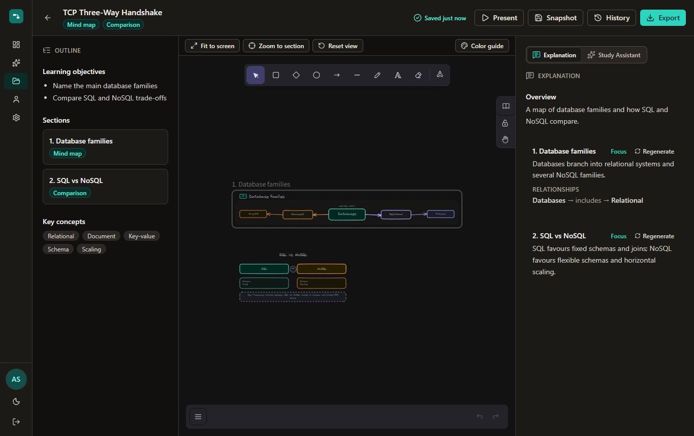 | 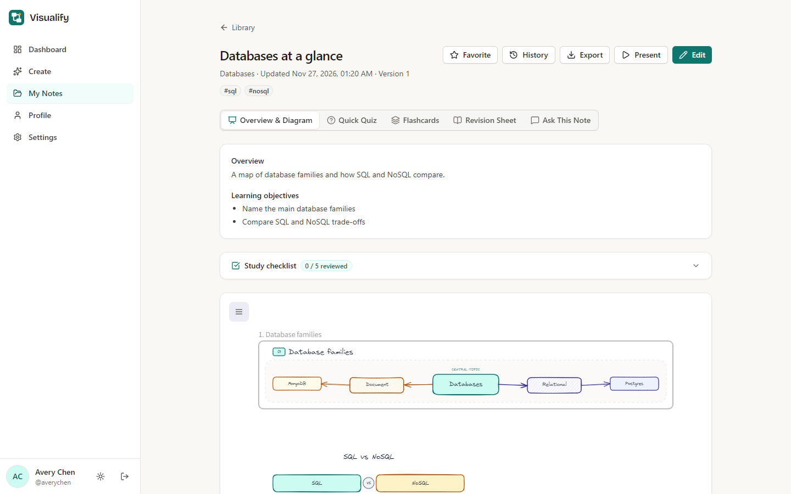 | 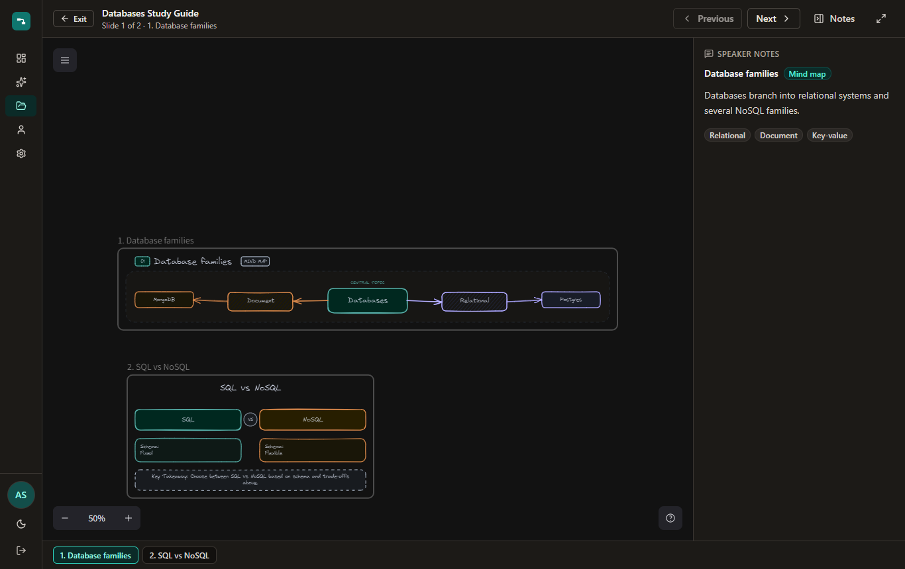 |

<details>
<summary><b>More screenshots: Dashboard, Create flow, Mobile viewport, Rendered diagram families &amp; Brand mark strip</b></summary>

| Create (Topic / PDF / Image) | Authenticated Dashboard (Dark) | Mobile Hero (`390px`) |
| :--- | :--- | :--- |
| 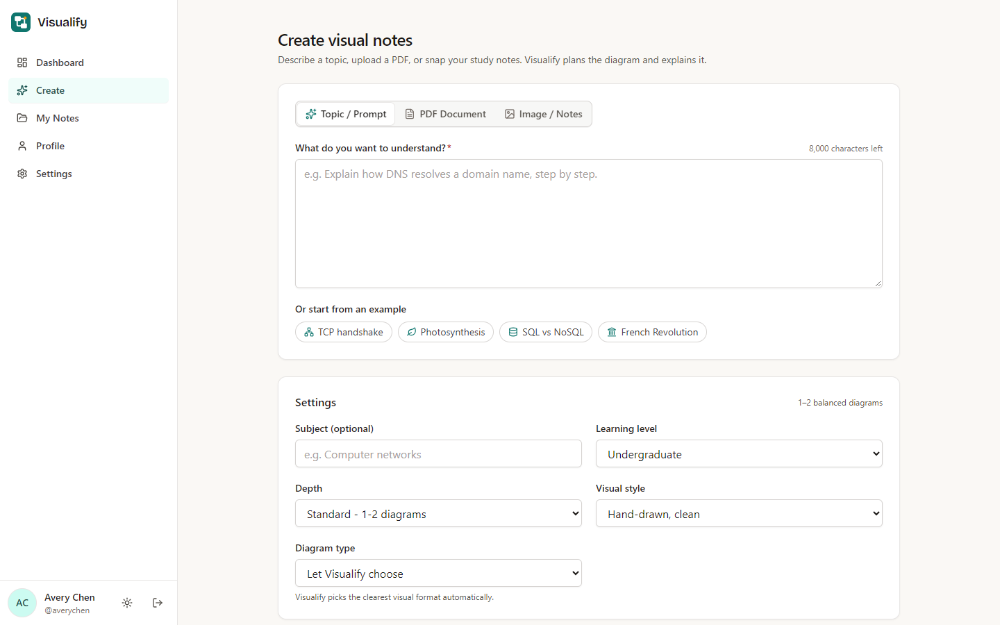 | 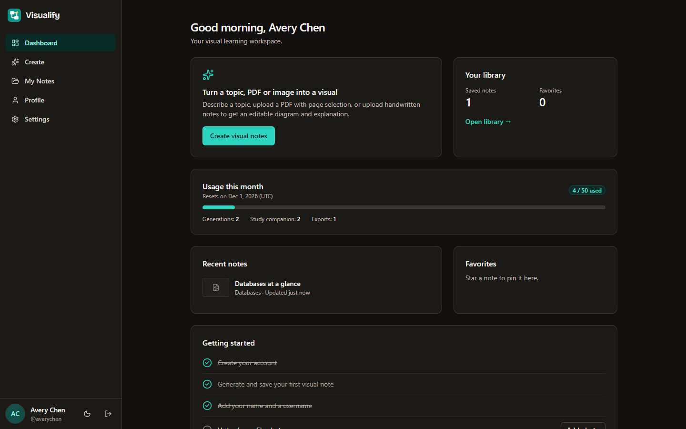 | 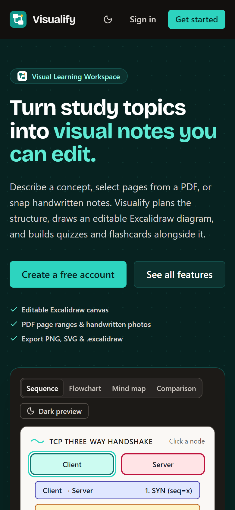 |

| Mind Map | Sequence Diagram | ER Diagram | Comparison Matrix |
| :--- | :--- | :--- | :--- |
| 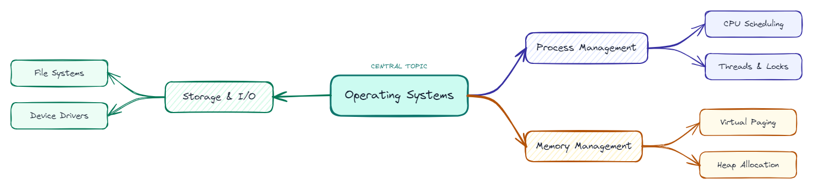 | 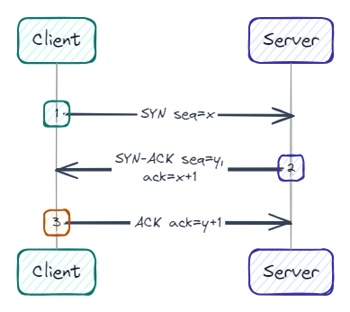 | 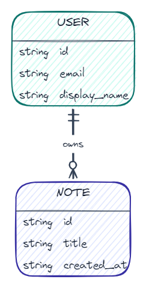 | 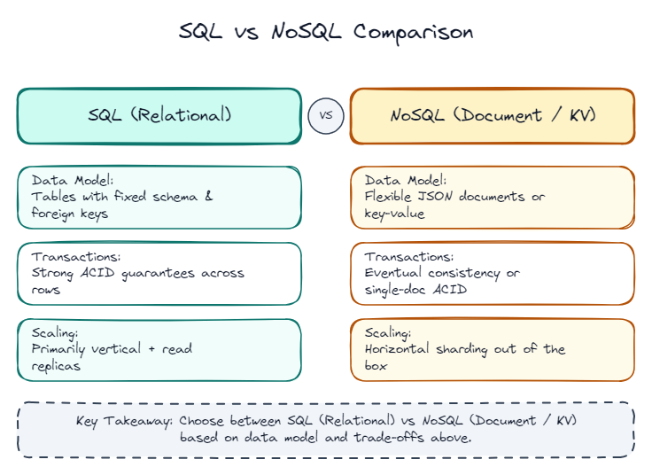 |

<p align="center">
  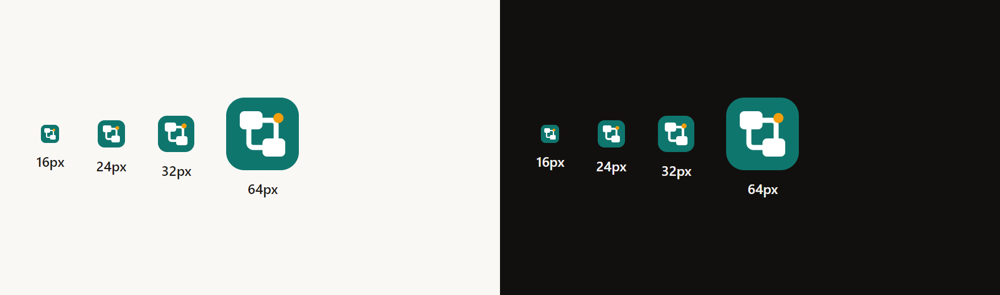
</p>

</details>

---

## 🧩 Core Capabilities

- **Multi-Source Generation**: Generate multi-section visuals from free-text prompts (`<= 4,000` chars), digital/scanned PDFs (`<= 20 MB`, explicit page-range selection up to `100` pages), or JPEG/PNG/WebP photos (auto-oriented with EXIF stripped).
- **7 Structured Visual Families**: Auto-selected or pinned per section — **Flowchart**, **Sequence**, **Mind Map**, **Comparison**, **Timeline**, **ER Diagram**, and **Class Diagram**.
- **True Canvas Editing**: Opens directly in `@excalidraw/excalidraw` with bound text containers, section outline focusing, selective section regeneration, manual autosave with `409` optimistic concurrency control, and restorable snapshots.
- **Learning Companion & Presentation**: One-click full-screen Presentation Mode (keyboard navigation + speaker notes), Explain Selected Shapes, difficulty-filtered Quizzes, active-recall Flashcards, condensed Revision Sheets, and source-grounded Ask Your Note Q&A.
- **Full & Selection Exports**: Export whole boards or specific selected elements to **PNG**, **SVG**, **`.excalidraw`**, or **Markdown/ZIP** bundles in light or dark canvas modes.
- **Library & Isolation**: Nested folders, tags, favorites, archive filtering, sort controls, monthly metered quotas, self-serve account deletion, and PostgreSQL **Row-Level Security** on every table and private storage bucket.

---

## 🏗 Architecture

Visualify deploys cleanly from one Node container image with two stateless process roles (`PROCESS_ROLE=api` and `PROCESS_ROLE=worker`) backed by Supabase Auth/Postgres/Storage and Redis/BullMQ.

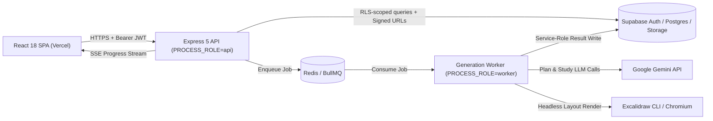

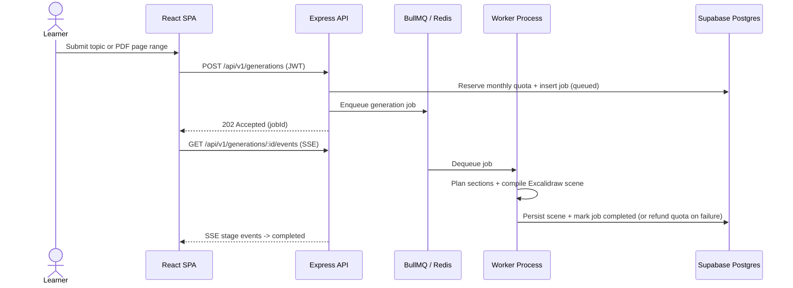

---

## 🛠 Pinned Tech Stack

All workspace dependencies are strictly version-pinned in `package.json` manifests (verified by `npm run lint`):

| Layer | Technologies |
| :--- | :--- |
| **Frontend** | `react@18.3.1`, `vite@8.3.8`, `tailwindcss@4.3.5`, `react-router-dom@7.18.5`, `@excalidraw/excalidraw@0.18.1`, `@tanstack/react-query@5.107.1`, `lucide-react@1.71.0`, `zod@4.6.7` |
| **Backend API** | Node `>=22`, `express@5.2.1`, `@supabase/supabase-js@2.119.0`, `bullmq@5.85.0`, `ioredis@5.10.1`, `helmet@8.1.0`, `pino@10.3.1`, `@sentry/node@10.48.0`, `zod@4.3.6` |
| **Worker Engine** | `@google/genai@1.53.0`, `@excalidraw/cli@0.0.1-beta.5`, `mermaid@11.14.0`, `pdf-parse@2.4.5`, `sharp@0.35.5`, `@sentry/node@10.48.0` |
| **Testing & QA** | `vitest@5.1.1`, `@electric-sql/pglite@1.0.2`, `supertest@7.3.0`, `@playwright/test@1.65.1`, `@axe-core/playwright@4.14.0` |

---

## ⚡ Quick Start

### 1. Install dependencies & configure templates

<details open>
<summary><b>PowerShell (Windows)</b></summary>

```powershell
git clone https://github.com/your-org/Visualizer.git
cd Visualizer
npm ci

Copy-Item frontend/.env.example frontend/.env.local
Copy-Item backend/.env.example backend/.env.local
Copy-Item backend/worker/.env.example backend/worker/.env.local
```

</details>

<details>
<summary><b>Bash (macOS / Linux)</b></summary>

```bash
git clone https://github.com/your-org/Visualizer.git
cd Visualizer
npm ci

cp frontend/.env.example frontend/.env.local
cp backend/.env.example backend/.env.local
cp backend/worker/.env.example backend/worker/.env.local
```

</details>

### 2. Apply Supabase migrations & run local dev

Run Supabase SQL migrations `supabase/migrations/0001` through `0010` cleanly against your project (see [supabase/README.md](supabase/README.md)), populate `.env.local` keys, then start both servers together:

```bash
npm run dev
```

Or launch separately:

```bash
npm run dev:api       # Express API + in-process worker on http://localhost:5000
npm run dev:frontend  # Vite SPA dev server on http://localhost:5173
```

---

## 🔐 Environment Variables

Never place server secrets (`SUPABASE_SERVICE_ROLE_KEY`, `GEMINI_API_KEY`, `REDIS_URL`) in frontend files or `VITE_*` variables. Verified automatically by `scripts/checkEnvDocs.js`.

<details open>
<summary><b>Backend API &amp; Shared Runtime (<code>backend/.env.local</code>)</b></summary>

| Variable | Default / Example | Required | Purpose |
| :--- | :--- | :--- | :--- |
| `NODE_ENV` | `development` | Yes | Runtime mode: `development`, `test`, `staging`, `production` |
| `PROCESS_ROLE` | `all` | No | Process mode: `all`, `api` (HTTP+SSE), or `worker` (BullMQ consumer) |
| `PORT` | `5000` | No | HTTP server port for API |
| `WORKER_HEALTH_PORT` | `5001` | No | Healthcheck HTTP port (`/healthz`) when `PROCESS_ROLE=worker` |
| `SHUTDOWN_GRACE_MS` | `25000` | No | Graceful drain window (ms) on `SIGTERM`/`SIGINT` |
| `FRONTEND_ORIGIN` | `http://localhost:5173` | Yes | Exact comma-separated allowed CORS origins (never `*`) |
| `SUPABASE_URL` | `https://...supabase.co` | Yes | Supabase project URL |
| `SUPABASE_PUBLISHABLE_KEY` | `sb_publishable_...` | Yes | Supabase anon/publishable key for RLS-scoped access |
| `SUPABASE_SERVICE_ROLE_KEY` | `sb_secret_...` | Prod / Jobs | Private server key for background result persistence & quota accounting |
| `GEMINI_API_KEY` | — | Jobs / Companion | Google Gemini API credential (`@google/genai`) |
| `GEMINI_MODEL` | `gemini-3.5-flash-lite` | No | Primary Gemini planner/companion model |
| `GEMINI_FALLBACK_MODELS` | `gemini-3.1-flash-lite` | No | Comma-separated fallback models (max 3) |
| `GENERATION_MAX_CONCURRENCY` | `2` | No | Concurrent jobs per process (`1..10`) |
| `RENDER_CONCURRENCY` | `2` | No | Simultaneous headless Chromium/Mermaid CLI renders (`1..8`) |
| `GENERATION_PLANNER_TIMEOUT_MS` | `90000` | No | Timeout per Gemini planning request |
| `GENERATION_JOB_TIMEOUT_MS` | `240000` | No | Hard job wall-clock ceiling |
| `EXCALIDRAW_BROWSER_PATH` | OS autodetect | No | Explicit Chrome/Chromium/Edge binary path for `@excalidraw/cli` |
| `CLI_RENDER_TIMEOUT_MS` | `30000` | No | Headless CLI render timeout (`1000..120000`) |
| `GENERATION_LIMIT_MONTHLY` | `50` | No | Monthly billable AI operations limit per user |
| `REDIS_URL` | — | Split roles | `redis://` or `rediss://` URL for BullMQ queue & distributed limiters |
| `SENTRY_DSN` | — | No | Server Sentry DSN (PII scrubbed before dispatch) |
| `ADMIN_USER_IDS` | — | No | Comma-separated UUIDs granted `/api/v1/admin/metrics` access |
| `AVATAR_MAX_BYTES` | `2097152` | No | Avatar upload size cap (`<= 5 MiB`) |
| `AVATAR_SIGNED_URL_TTL_SECONDS` | `300` | No | Signed URL expiry for private avatars |
| `SOURCE_MAX_BYTES` | `20971520` | No | Source PDF/image upload cap (`<= 20 MiB`) |
| `SOURCE_MAX_PDF_PAGES` | `100` | No | Maximum PDF pages selectable per generation |
| `SOURCE_SIGNED_URL_TTL_SECONDS` | `300` | No | Signed URL expiry for uploaded source files |
| `TRUST_PROXY` | `false` | Prod | Set `true` behind a single trusted reverse proxy |
| `LOG_LEVEL` | `info` | No | Pino verbosity (`fatal`, `error`, `warn`, `info`, `debug`, `trace`, `silent`) |

</details>

<details>
<summary><b>Frontend SPA (<code>frontend/.env.local</code>)</b></summary>

| Variable | Default / Example | Required | Purpose |
| :--- | :--- | :--- | :--- |
| `VITE_SUPABASE_URL` | `https://...supabase.co` | Yes | Public Supabase project URL |
| `VITE_SUPABASE_PUBLISHABLE_KEY` | `sb_publishable_...` | Yes | Public anon key (enforced by RLS) |
| `VITE_API_BASE_URL` | `http://localhost:5000` | Yes | Express API origin (no trailing slash) |
| `VITE_SENTRY_DSN` | — | No | Optional browser Sentry DSN (`build.sourcemap` stays `false`) |

</details>

---

## 🎨 Brand, Motion & Asset Scripts

- **Design System**: Read [`docs/design/DESIGN.md`](docs/design/DESIGN.md) for color palette contrast ratios (`>= 4.5:1` WCAG AA across light & dark), display font pairing (`Bricolage Grotesque Variable`), surface motion tiers, and progressive `prefers-reduced-motion` safeguards.
- **Generate Favicons, PWA Icons & OG Card** from `frontend/src/brand/markGeometry.js`:
  ```bash
  npm run brand:assets
  ```
- **Regenerate Light & Dark Documentation Screenshots**:
  ```bash
  npm run docs:screenshots
  ```

---

## 🚢 Deployment & Security

- **Frontend (`vercel.json` + [`deploy/origins.json`](deploy/origins.json))**: Strict non-wildcard CSP enforced in automated tests (`frontend/src/lib/phase6.test.js`), pre-paint theme script hash verified via SHA-256, `sourcemap: false`, static asset caching headers.
- **API & Worker ([`Dockerfile`](Dockerfile) + [`render.yaml`](render.yaml))**: Multi-stage Node 22 + Chromium image split cleanly into `visualify-api` (`PROCESS_ROLE=api`) and `visualify-worker` (`PROCESS_ROLE=worker`) over Redis/BullMQ. Production fails closed if `SUPABASE_SERVICE_ROLE_KEY` or `REDIS_URL` is missing for split roles.
- **Verification Gate**: Run all checks from root:
  ```bash
  npm run lint            # Syntax + pinned deps + secret scan + env/README doc checks
  npm run test            # Worker, API, PGlite SQL/RLS, Frontend unit tests
  npm run test:e2e        # Playwright end-to-end + Axe WCAG 2.2 AA + perf & motion checks
  npm run eval:quality    # Offline/live AI quality benchmark suite
  npm run test:rls:live   # Live Supabase RLS suite (requires .env.local test DB)
  ```

---

## 📁 Project Structure

<details>
<summary><b>Repository tree overview</b></summary>

```text
Visualizer/
├── frontend/
│   ├── public/               favicon.*, apple-touch-icon.png, icon-*, og-image.png, fonts/, diagrams/
│   └── src/
│       ├── brand/            BrandMark.jsx + canonical markGeometry.js + tests
│       ├── motion/           Reveal, Float, Collapse, SlidingIndicator, useReducedMotion, useCountUp
│       ├── features/
│       │   ├── marketing/    LandingPage + landing/ modules, FeaturesPage, PublicLayout, LegalPages
│       │   ├── dashboard/    Dashboard, quota meter & recent notes
│       │   ├── create/       Topic prompt, PDF page-range & EXIF-safe image create flow
│       │   ├── generation/   SSE progress tracker & Excalidraw WorkspaceCanvas
│       │   ├── notes/        Library, NoteRead, NoteEditor, NotePresent & active-recall study/ suite
│       │   ├── profile/      Profile, avatar crop/upload, Settings & account deletion
│       │   └── admin/        Privacy-preserving launch telemetry view
│       └── styles/index.css  Tailwind v4 @theme palette, dark mode remaps & motion CSS tokens
├── backend/
│   ├── src/                  Express 5 API, auth middleware, quotas, generation/ pipeline, BullMQ, SSE
│   └── worker/               Gemini planner/companion, 7 diagram compilers, @excalidraw/cli renderer & eval
├── supabase/
│   ├── migrations/           0001..0010 RLS schemas, buckets, study packs, quotas & product_events
│   └── tests/                PGlite + live Postgres RLS verification suites
├── deploy/origins.json       Canonical staging/production frontend & API origins
├── docs/design/DESIGN.md     Visual tokens, WCAG contrast table & 3-tier motion specification
├── scripts/                  lint.js, generateBrandAssets.js, captureReadmeScreenshots.js, checkEnvDocs.js, checkReadme.js
└── tests/e2e/                Playwright specs (brand, landing, motion, perf, auth, generation, notes, theme)
```

</details>

---

## 📍 Roadmap

- [x] **Phase 0**: Technical spike — Gemini structured planner, diagram adapters, CLI rendering, Excalidraw integration
- [x] **Phase 1**: Foundation — Supabase Auth, RLS profiles, private avatars, Express API & app shell
- [x] **Phase 2**: Prompt-to-Visual MVP — async jobs, SSE progress streaming, cancel/retry & workspace
- [x] **Phase 3**: Notes Library — folders, autosave (`409` conflict handling), snapshots, version history, Light/Dark themes & exports
- [x] **Phase 4**: Multimodal Inputs — PDF page-range extraction, EXIF-safe image notes & source-referenced explanations
- [x] **Phase 5**: Learning Companion — Presentation mode, explain-this-selection, Quiz, Flashcards, Revision sheet, Ask your note & `.zip` export
- [x] **Phase 6**: Launch Hardening — monthly quota accounting, Redis/BullMQ queues, selection export, account deletion & CSP
- [x] **Phase 6.5**: Deployability & Evidence Gate — split `api`/`worker` image, 30-fixture AI quality benchmark, quota refunds & `product_events`
- [x] **Phase 6.6**: Brand Identity, Signature Landing Page, Site-Wide Motion System, Production CSP Fix & Reproducible Docs
- [ ] **Phase 7**: Expansion — read-only share links, cross-note source Q&A & classroom collaboration *(gated per [PRD.MD §17](PRD.MD))*

---

## 📚 Documentation

| Document | Scope |
| :--- | :--- |
| [PRD.MD](PRD.MD) | Full product requirements (Phases 0–7) |
| [docs/design/DESIGN.md](docs/design/DESIGN.md) | Visual tokens, verified contrast pairs & motion tier specification |
| [docs/operations/runbook.md](docs/operations/runbook.md) | Alerts, incident response, backup/restore & support workflow |
| [docs/phase-6/phase-6.5-closeout-report.md](docs/phase-6/phase-6.5-closeout-report.md) | Launch close-out, model eval decision & split-role architecture |
| [supabase/README.md](supabase/README.md) | Database migrations, Auth URLs & OAuth configuration |
| [Agents.MD](Agents.MD) | Engineering, code quality & security rules |

---

<div align="center">
<sub>MIT / Internal Educational Platform · Built with care for learners who think in pictures.</sub>
</div>
