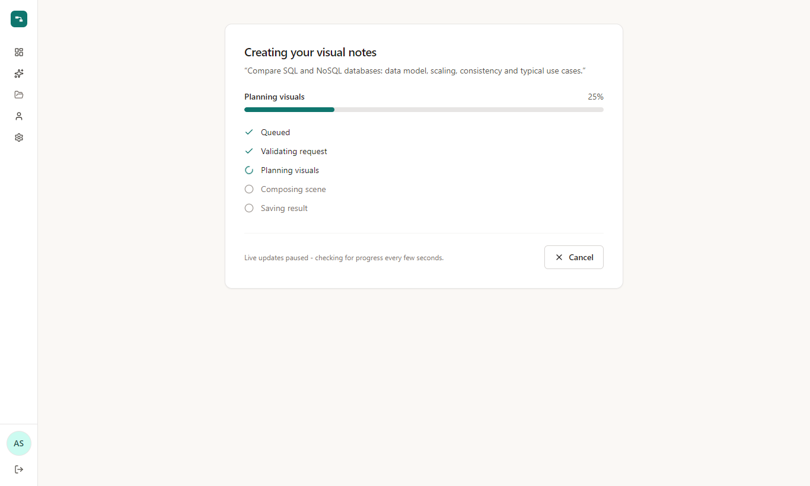
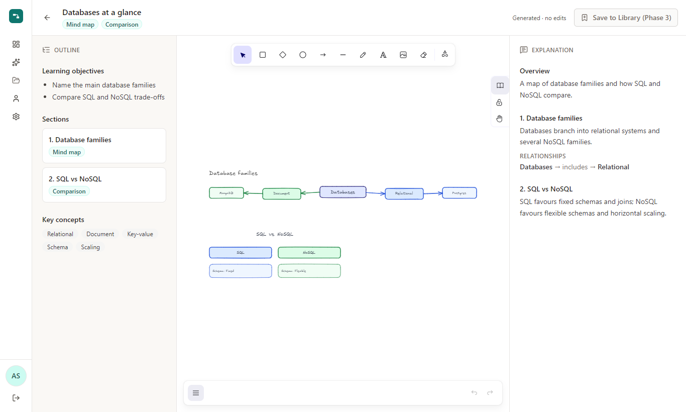
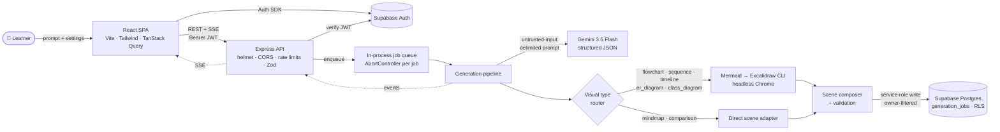
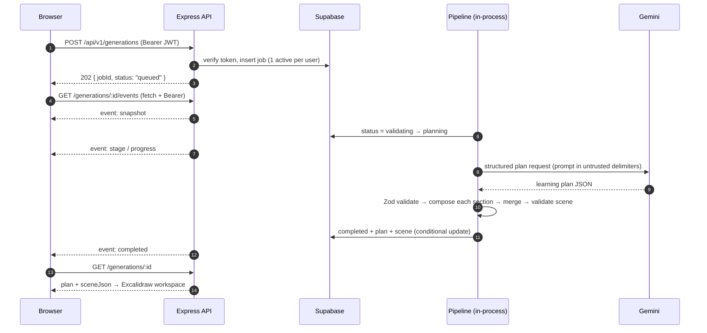
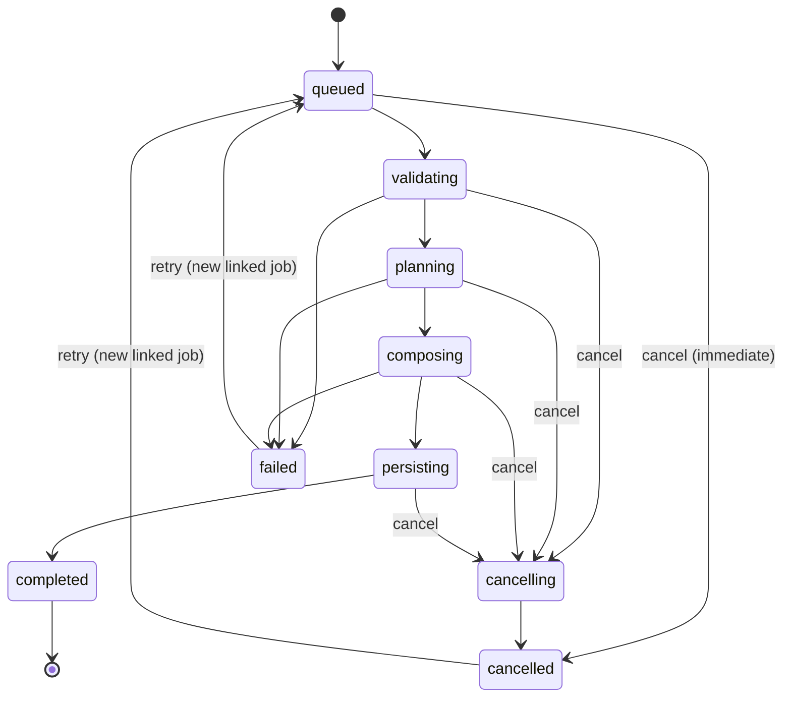
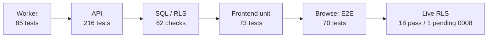

<div align="center">


# Visualify

### Turn any study topic into an editable visual explanation.

Describe a concept, and Visualify plans the right diagram, draws it as an **editable Excalidraw canvas**, and explains it section by section.

<p>
  
  
  
  
  
  
  
</p>
<p>
  
  
  
</p>

[**Quick start**](#-quick-start) · [**How it works**](#-how-it-works) · [**API**](#-api-reference) · [**Testing**](#-testing) · [**Roadmap**](#-roadmap) · [**Docs**](#-documentation)

</div>

---

<table>
  <tr>
    <td width="50%"></td>
    <td width="50%"></td>
  </tr>
  <tr>
    <td align="center"><b>1. Describe a topic</b><br/><sub>Prompt, examples and settings</sub></td>
    <td align="center"><b>2. Watch it build</b><br/><sub>Live progress over SSE, cancellable</sub></td>
  </tr>
  <tr>
    <td colspan="2"></td>
  </tr>
  <tr>
    <td colspan="2" align="center"><b>3. Learn and edit</b><br/><sub>Outline · editable canvas · section-by-section explanation</sub></td>
  </tr>
</table>

> [!NOTE]
> **Status: Phase 5 (Multi-Frame Presentation Mode, AI Study Companion & Section Regeneration) is implemented and verified offline & in Playwright E2E**, including automated WCAG 2 AA contrast checks in Light & Dark modes across desktop (`1366x860`) and mobile (`390x844`).
> Live RLS checks for `0001`–`0007` pass (`18/18`); apply `0008_learning_companion.sql` in Supabase SQL Editor to enable the remaining live Phase 5 RLS check (`npm run test:rls:live`).

<details>
<summary><b>📑 Table of contents</b></summary>

- [What it does today](#-what-it-does-today)
- [How it works](#-how-it-works)
- [Design decisions](#-design-decisions)
- [Tech stack](#-tech-stack)
- [Quick start](#-quick-start)
- [Environment variables](#-environment-variables)
- [Scripts](#-scripts)
- [Testing](#-testing)
- [API reference](#-api-reference)
- [Security](#-security)
- [Project structure](#-project-structure)
- [Roadmap](#-roadmap)
- [Documentation](#-documentation)
- [Contributing](#-contributing)

</details>

---

## ✨ What it does today

| | Feature | Details |
|:-:|:--|:--|
| 🧠 | **Prompt, PDF & Image → learning plan** | Gemini returns a *structured, schema-validated* plan (title, objectives, sections, key concepts, relationships, explanations, `sourceRefs`), from prompts, PDF page selections (digital or scanned), or EXIF-sanitized note images. |
| 🎨 | **7 diagram types + bound Excalidraw scenes** | Flowchart · Sequence · Timeline · ER · Class (Mermaid → Excalidraw CLI with semantic palette enrichment) and Mind map · Comparison (deterministic container-bound & connector-bound scenes across 3 visual style presets). |
| ✏️ | **Editable canvas, autosave & section regen** | Results open in an embedded Excalidraw editor with genuine section `frame` groups; save to library, edit with debounced autosave (`note_drafts`), explain any canvas selection (`Study Assistant`), and non-destructively regenerate an individual section (`Regenerate`). |
| 🎞️ | **Presentation mode** | Full-bleed `/app/notes/:noteId/present` slide view over ordered scene frames with keyboard shortcuts (`ArrowRight`/`Space`/`PageDown`, `ArrowLeft`/`PageUp`, `N` notes, `F` fullscreen, `Escape`), clickable filmstrip, and smooth camera transitions. |
| 🎓 | **Interactive Study Companion** | Per-note study suite backed by Postgres (`note_quizzes`, `note_flashcards`, `note_revision_guides`) with **Quick Quiz** (scoring + persistent attempts), **Flashcards** (3D flip + mastery tracking), **Revision Sheet** (one-page cheat sheet), and **Ask This Note** (Q&A grounded in section/page citations). |
| 🗂️ | **Notes library & folders** | Grid/list views, nested folders (with cycle & depth guards), search, tag filtering, favorites, archive, duplicate, rename, move, and delete. |
| 🕰️ | **Version history** | Immutable snapshots (`note_versions`), live canvas preview of any prior version, and non-destructive restore that preserves unsnapshotted drafts first. |
| 📦 | **Exports** | Export Full scene, single frame (`scope: "frame"`), or multi-slide ordered archive (`.zip` with PNG/SVG slides + `manifest.json`), plus editable `.excalidraw` JSON served via signed URLs. |
| 🌗 | **Light / Dark / System theme** | Instant theme switcher synced to `localStorage` and profile preferences, WCAG 2 AA verified across public and app routes. |
| 📡 | **Live progress** | Server-Sent Events over `fetch` with the Bearer header, plus automatic polling fallback. Cancel and retry are built in. |
| 🧩 | **Partial success** | If one section's diagram fails, you still get the rest plus a clear warning; the job fails only if nothing can be drawn. |
| 🔐 | **Accounts** | Email/password with verification, Google OAuth, password recovery, profile, private avatar uploads. |
| 📱 | **Responsive** | Three panels from 1200 px, tabs on tablet, and a phone layout that stays usable. Keyboard and screen-reader friendly. |

---

## 🧭 How it works

Visualify **separates thinking from drawing**: the model decides *what to teach and which diagram fits*; deterministic code decides *where every shape goes*.



<details>
<summary><b>🔁 Lifecycle of one generation request</b> (sequence diagram)</summary>



</details>

<details>
<summary><b>🚦 Job state machine</b></summary>



Progress is a stage-weighted UX signal that **never moves backwards**. Every runner write is conditional on the current status, so a cancel can never be overwritten by "completed".

</details>

---

## 🧠 Design decisions

<details>
<summary><b>Why does the model return a plan instead of a drawing?</b></summary>

Free-form canvas JSON from an LLM is fragile: overlapping shapes, dangling arrows, invalid IDs. Visualify asks Gemini for a compact **learning plan** validated with Zod (bounded node counts, unique IDs, valid references), then **deterministic adapters** build the scene. Output quality becomes testable and repeatable.

</details>

<details>
<summary><b>How is prompt injection handled?</b></summary>

The learner's text is wrapped in `<untrusted_user_input>` delimiters; look-alike delimiters inside the text are neutralised so it can't "close" the block. The system instruction treats that block strictly as data. Model output is validated twice (worker + API) and never rendered unvalidated.

</details>

<details>
<summary><b>Why can't users write their own job results?</b></summary>

RLS lets users **create, read and cancel** their own jobs, but status, plan and scene are written only by the server runner. Phase 3 will turn completed jobs into saved notes, so a client must never be able to plant a fake "completed" job with an arbitrary scene. This is verified by SQL tests and live RLS tests.

</details>

<details>
<summary><b>Why an in-process queue instead of Redis?</b></summary>

It keeps local development dependency-free. The service depends only on an `enqueue / cancel / isTracked` interface, so **BullMQ can replace it** without touching routes or the pipeline. Jobs orphaned by a crash are marked `INTERRUPTED` on boot.

> [!IMPORTANT]
> The in-process runner assumes **a single API instance**. Add BullMQ/Redis before scaling horizontally.

</details>

---

## 🧰 Tech stack

| Layer | Technology |
|:--|:--|
| **Frontend** | React `18.3.1` (pinned for Excalidraw) · Vite `8` · Tailwind CSS `4` · React Router `7` · TanStack Query `5` · React Hook Form + Zod · lucide-react |
| **Canvas** | `@excalidraw/excalidraw` `0.18.1` (lazy-loaded) |
| **API** | Node.js `22+` · Express `5` · helmet · cors · express-rate-limit · multer · sharp · file-type · pino |
| **AI** | Gemini via `@google/genai` · structured JSON output · Zod `4` |
| **Diagrams** | Mermaid → `@excalidraw/cli` with headless Chrome/Chromium/Edge |
| **Data** | Supabase Auth · Postgres with RLS · private Storage |
| **Testing** | Vitest · Supertest · PGlite (real Postgres in WASM) · Playwright |

---

## 🚀 Quick start

> [!TIP]
> Everything except live generation works **offline**: `npm install && npm test` needs no keys.

### 1. Prerequisites

- **Node.js 22+**
- **Chrome, Chromium or Edge** (used headlessly to convert Mermaid diagrams)
- A **Supabase** project and a **Gemini API key** (for the full app)

### 2. Install

```bash
git clone https://github.com/kanishk3114S/Visualizer.git
cd Visualizer
npm install
```

### 3. Configure environment

<details open>
<summary><b>PowerShell (Windows)</b></summary>

```powershell
Copy-Item frontend\.env.example frontend\.env.local
Copy-Item backend\.env.example  backend\.env.local
Copy-Item backend\worker\.env.example backend\worker\.env.local
```

</details>

<details>
<summary><b>Bash (macOS / Linux / WSL)</b></summary>

```bash
cp frontend/.env.example frontend/.env.local
cp backend/.env.example  backend/.env.local
cp backend/worker/.env.example backend/worker/.env.local
```

</details>

Fill in the values (see [Environment variables](#-environment-variables)). `.env.local` files are git-ignored. **Never commit them.**

### 4. Set up Supabase

Run the migrations **in order** in the Supabase SQL Editor (or with `supabase db push`):

```text
supabase/migrations/0001_profiles_and_rls.sql
supabase/migrations/0002_avatars_storage_bucket.sql
supabase/migrations/0003_generation_jobs.sql
supabase/migrations/0004_folders_notes_versions_exports.sql
supabase/migrations/0005_note_storage_buckets.sql
supabase/migrations/0006_source_files.sql
supabase/migrations/0007_source_files_bucket.sql
supabase/migrations/0008_learning_companion.sql
```

Then configure the Auth redirect URLs and Google OAuth: step-by-step in [`supabase/README.md`](supabase/README.md).

### 5. Run it

```bash
npm run dev:api        # Express API  → http://localhost:5000
npm run dev:frontend   # React app    → http://localhost:5173
```

Sign up, open **Create**, pick an example and hit **Generate visual**. 🎉

---

## 🔑 Environment variables

<details>
<summary><b>Show all variables</b></summary>

| Variable | File | Secret? | Purpose |
|:--|:--|:-:|:--|
| `VITE_SUPABASE_URL` | `frontend/.env.local` | — | Supabase project URL |
| `VITE_SUPABASE_PUBLISHABLE_KEY` | `frontend/.env.local` | — | Publishable key (safe in the browser *because* RLS is enforced) |
| `VITE_API_BASE_URL` | `frontend/.env.local` | — | API origin, e.g. `http://localhost:5000` |
| `SUPABASE_URL` / `SUPABASE_PUBLISHABLE_KEY` | `backend/.env.local` | — | Token verification and RLS-scoped access |
| `SUPABASE_SERVICE_ROLE_KEY` | `backend/.env.local` | 🔒 | **Server only.** Used by the job runner to write results |
| `FRONTEND_ORIGIN` | `backend/.env.local` | — | Exact CORS allowlist (comma-separated, never `*`) |
| `GEMINI_API_KEY` | `backend/.env.local` or `backend/worker/.env.local` | 🔒 | **Server only.** Model access |
| `GEMINI_MODEL` | same | — | Default `gemini-3.5-flash` |
| `GENERATION_MAX_CONCURRENCY` | `backend/.env.local` | — | Jobs running at once (default `2`) |
| `GENERATION_PLANNER_TIMEOUT_MS` / `GENERATION_JOB_TIMEOUT_MS` | `backend/.env.local` | — | Per-call and whole-job limits |
| `EXCALIDRAW_BROWSER_PATH` | `backend/worker/.env.local` | — | Browser for Mermaid conversion (auto-detected if unset) |
| `AVATAR_MAX_BYTES` / `AVATAR_SIGNED_URL_TTL_SECONDS` | `backend/.env.local` | — | Avatar limits |

Generation returns `503 GENERATION_UNAVAILABLE` until **both** `SUPABASE_SERVICE_ROLE_KEY` and `GEMINI_API_KEY` are set.

</details>

> [!CAUTION]
> Never put a secret in a `VITE_*` variable. Vite bundles every `VITE_*` value into the browser build.

---

## 📜 Scripts

| Command | What it does |
|:--|:--|
| `npm run dev:api` | Start the Express API with file watching |
| `npm run dev:frontend` | Start the Vite dev server |
| `npm run build:frontend` | Production build (no source maps) |
| `npm test` | **All offline suites**: worker → API → SQL/RLS → frontend unit |
| `npm run test:worker` · `test:api` · `test:frontend` | Individual suites |
| `npm run test:rls:sql` | Migrations + RLS on real Postgres (PGlite), no credentials needed |
| `npm run test:e2e` | Playwright browser tests (mocked API) |
| `npm run test:rls:live` | Cross-user RLS checks against your **live** dev project |
| `npm run smoke:generation` | Real Gemini + CLI pipeline, in-memory store (1 model call) |
| `npm run smoke:live-api` | Real API + live Supabase + Gemini: recovery, generation, cancel (throwaway users, cleaned up) |
| `npm run spike:local` | Phase 0: render all 7 diagram types to `renders/` |

---

## 🧪 Testing



| Layer | Tooling | Highlights |
|:--|:--|:--|
| Worker | Vitest | Schema edge cases, multi-frame scene composition, study companion schemas & injection hardening, PDF/image extraction, real `@excalidraw/cli` frame rendering, cancellation |
| API | Vitest + Supertest | Auth before body parsing, source uploads, SSE, notes/folders CRUD, autosave conflicts, versions, frame/ZIP exports, companion quiz/flashcard/revision/ask/regenerate endpoints & rate limits |
| Database | PGlite | Real migrations `0001`–`0008`; cross-user denial; immutable versions; `source_files` ownership; `note_quizzes`/`note_flashcards`/`note_revision_guides`/`usage_events` RLS & storage `application/zip` |
| Frontend | Vitest | SSE parser, `returnTo` open-redirect guard, theme helpers, source validation, autosave/library filters, frame extraction & selection helpers, schemas |
| E2E | Playwright + Axe | Interactive showcase, PDF/image flows, save/library/versions/export (`.zip`), Presentation mode, Quiz/Flashcards/Revision/Ask, Study Assistant explain & section regen, Light/Dark WCAG 2 AA audit |
| Live | node:test + scripts | Cross-user RLS (`0001`–`0007` pass `18/18`; `0008` ready once applied) |

<sub>Counts as of Phase 5 verification. Full results: [`docs/phase-5/phase-5-report.md`](docs/phase-5/phase-5-report.md).</sub>

---

## 📡 API reference

All responses use one envelope:

```json
{ "success": true, "data": { "jobId": "…", "status": "queued" }, "error": null, "meta": { "requestId": "req_…" } }
```

<details>
<summary><b>Endpoints</b></summary>

| Method | Path | Auth | Notes |
|:--|:--|:-:|:--|
| `GET` | `/api/v1/health` | — | API + Supabase reachability; no secrets |
| `GET` | `/api/v1/me` | 🔒 | Profile + short-lived signed avatar URL |
| `PATCH` | `/api/v1/me` | 🔒 | `display_name`, `username`, `bio`, `preferences` |
| `POST` / `DELETE` | `/api/v1/me/avatar` | 🔒 | Magic-byte check → WebP 256 px, EXIF stripped |
| `POST` | `/api/v1/sources/upload` | 🔒 | Upload PDF/JPEG/PNG/WebP (`20 MB` max); magic-byte checked, EXIF stripped |
| `GET` / `DELETE` | `/api/v1/sources/:sourceFileId` | 🔒 | Source file metadata + signed preview / owner-scoped delete |
| `POST` | `/api/v1/generations` | 🔒 | `202` queued (`prompt`, `pdf`, `image`) · `409 ACTIVE_JOB_EXISTS` · `429` rate limited |
| `GET` | `/api/v1/generations/:jobId` | 🔒 | Status, progress, plan, scene, warnings, safe error |
| `GET` | `/api/v1/generations/:jobId/events` | 🔒 | **SSE**: `snapshot`, `stage`, `progress`, `completed`, `failed`, `cancelled` + heartbeats |
| `POST` | `/api/v1/generations/:jobId/cancel` | 🔒 | Idempotent: `200` cancelled · `202` cancelling |
| `POST` | `/api/v1/generations/:jobId/retry` | 🔒 | Failed/cancelled only; creates a linked attempt |
| `GET` / `POST` | `/api/v1/folders` | 🔒 | List tree / create folder |
| `PATCH` / `DELETE` | `/api/v1/folders/:folderId` | 🔒 | Rename/move folder (cycle guard) / delete folder safely |
| `GET` / `POST` | `/api/v1/notes` | 🔒 | Filter/search/sort library / save completed generation as note |
| `GET` / `PATCH` / `DELETE` | `/api/v1/notes/:noteId` | 🔒 | Note detail (latest draft or current version), update metadata, delete |
| `POST` | `/api/v1/notes/:noteId/duplicate` | 🔒 | Independent copy from latest saved state |
| `GET` / `POST` | `/api/v1/notes/:noteId/versions` | 🔒 | List history / create immutable snapshot |
| `GET` | `/api/v1/notes/:noteId/versions/:versionId` | 🔒 | Preview specific historical version |
| `POST` | `/api/v1/notes/:noteId/restore/:versionId` | 🔒 | Non-destructive restore (keeps unsnapshotted draft first) |
| `PUT` | `/api/v1/notes/:noteId/draft` | 🔒 | Autosave draft with optimistic revision (`409 DRAFT_CONFLICT`) |
| `POST` | `/api/v1/notes/:noteId/exports` | 🔒 | Render Full scene, single frame (`scope: "frame"`), or multi-slide `.zip` archive (`PNG`/`SVG`/`excalidraw`) |
| `GET` | `/api/v1/exports/:exportId` | 🔒 | Export status and short-lived signed download URL |
| `GET` | `/api/v1/notes/:noteId/study` | 🔒 | Load persisted quizzes, flashcard deck + mastery stats, and revision sheet |
| `POST` | `/api/v1/notes/:noteId/explain` | 🔒 | Contextual explanation for selected canvas element(s) or section |
| `POST` / `PATCH` | `/api/v1/notes/:noteId/quiz` · `/quiz/:quizId` | 🔒 | Generate quiz (`easy`/`mixed`/`hard`) · persist learner answer attempts & score |
| `POST` / `PATCH` | `/api/v1/notes/:noteId/flashcards` · `/flashcards/:cardId` | 🔒 | Generate/replace flashcard deck · update card mastery (`new`/`learning`/`mastered`) |
| `POST` | `/api/v1/notes/:noteId/revision` | 🔒 | Generate/refresh structured Markdown revision cheat sheet (`revision_sheet`) |
| `POST` | `/api/v1/notes/:noteId/ask` | 🔒 | Grounded note Q&A returning cited `sectionIds` and `pageRefs` |
| `POST` | `/api/v1/notes/:noteId/sections/:sectionId/regenerate` | 🔒 | Snapshot pre-regen backup version, regenerate one section with custom instruction, splice cleanly |

Unknown, malformed and other users' job IDs all return the **same 404**.

</details>

<details>
<summary><b>Create a generation (curl)</b></summary>

```bash
curl -X POST http://localhost:5000/api/v1/generations \
  -H "Authorization: Bearer <supabase-access-token>" \
  -H "Content-Type: application/json" \
  -d '{
        "inputType": "prompt",
        "prompt": "Explain the TCP three-way handshake",
        "settings": { "audienceLevel": "undergraduate", "detail": "standard", "preferredOutput": "auto" }
      }'
```

</details>

<details>
<summary><b>SSE stream example</b></summary>

```text
retry: 3000

event: snapshot
data: {"status":"queued","stage":null,"progress":0}

event: stage
data: {"status":"planning","stage":"planning","progress":12}

event: progress
data: {"progress":34}

: heartbeat

event: completed
data: {"status":"completed","progress":100}
```

> Browsers' `EventSource` can't send headers, so the client reads the stream with `fetch()` + `ReadableStream`. **Tokens never go in URLs.**

</details>

---

## 🔒 Security

- **Row Level Security everywhere**: explicit per-command owner policies; no `USING (true)`; grants scoped per column.
- **Identity from the token only**: request bodies can't choose an owner ID; unknown fields are rejected.
- **Secrets stay server-side**: service-role and Gemini keys never reach the browser; bundle scanned on every phase.
- **Hardened HTTP**: helmet with deny-all CSP, HSTS, `X-Frame-Options: DENY`, strict CORS allowlist, per-user rate limits.
- **Safe failures**: fixed error codes and messages; no stack traces, provider text or paths in responses.
- **Private by default**: avatars re-encoded (metadata stripped) in a private bucket behind 5-minute signed URLs; prompts are never logged.
- **Safe redirects**: `returnTo` accepts same-origin app paths only (blocks `//evil.com`, `/\evil.com`, tab/newline tricks).

---

## 📁 Project structure

<details>
<summary><b>Show tree</b></summary>

```text
Visualizer/
├── frontend/                 React SPA (Vite, Tailwind)
│   └── src/
│   │   ├── app/              router, providers, guards, app shell, ThemeContext
│   │   ├── components/       Button, Field, Toast, ConfirmDialog, Menu, Modal, ThemeToggle, Avatar…
│   │   ├── features/
│   │   │   ├── auth/         login, signup, OAuth callback, password reset
│   │   │   ├── create/       prompt + settings form
│   │   │   ├── generation/   progress, workspace, lazy Excalidraw canvas
│   │   │   ├── notes/        LibraryPage, NoteReadPage, NoteEditorPage, NotePresentPage, study/, VersionHistory, ExportDialog
│   │   │   ├── profile/      profile, avatar, settings, preferences pages
│   │   │   └── marketing/    landing, features, legal, 404
│   │   ├── hooks/            useProfile, useGenerationJob, useNotes, useAutosave
│   │   └── lib/              api client, SSE parser, schemas, theme, autosave, libraryFilters, frames, supabase
│   ├── backend/                  Express API (@visualify/api)
│   │   ├── src/
│   │   │   ├── generation/       queue, event bus, job store, pipeline, service
│   │   │   ├── notes/            repository, service, renderer, zipArchive, noteFiles, errors
│   │   │   ├── controllers/  routes/  middleware/  schemas/  services/
│   │   │   └── app.js · server.js
│   │   ├── scripts/              live smoke tests
│   │   ├── tests/                Vitest + Supertest
│   │   └── worker/               generation worker (@visualify/worker)
│   │       └── src/              Gemini planner, schemas, adapters, CLI renderer
│   ├── supabase/
│   │   ├── migrations/           0001 profiles · 0002 avatars · 0003 generation_jobs · 0004 notes/versions/exports · 0005 note buckets · 0006 source_files · 0007 source-files bucket · 0008 learning_companion
│   │   └── tests/                PGlite + live RLS suites
├── tests/e2e/                Playwright specs + API mocks
└── docs/                     phase reports, decisions, screenshots
```

</details>

---

## 📍 Roadmap

- [x] **Phase 0**: Technical spike: Gemini plans, Mermaid/direct adapters, CLI rendering, Excalidraw embed
- [x] **Phase 1**: Foundation: auth, profiles, avatars, RLS, secure Express API, app shell
- [x] **Phase 2**: Prompt-to-visual MVP: async jobs, SSE progress, cancel/retry, visual workspace
- [x] **Phase 3**: Notes library, autosave, version history, PNG/SVG/`.excalidraw` export, Light/Dark theme *(live RLS `0001`–`0005` passing `16/16`)*
- [x] **Phase 4**: PDF & image inputs, Excalidraw diagram binding/palette upgrade & UI/UX polish *(live RLS `0001`–`0007` passing `18/18`)*
- [x] **Phase 5**: Learning companion: multi-frame presentation mode, explain-this-node, quizzes, flashcards, revision sheet, note Q&A, section regeneration & `.zip` export *(offline & E2E verified; apply `0008` for live RLS)*
- [ ] **Phase 6**: Launch hardening: quotas, monitoring, abuse controls, staging + production
- [ ] **Phase 7**: Expansion: source Q&A, sharing, collaboration

---

## 📚 Documentation

| Document | What's inside |
|:--|:--|
| [`PRD.MD`](PRD.MD) | Full product requirements, Phases 0–7 |
| [`docs/phase-5/phase-5-report.md`](docs/phase-5/phase-5-report.md) | Phase 5 multi-frame scenes, presentation mode, study companion, section regeneration & verification |
| [`docs/phase-4/phase-4-report.md`](docs/phase-4/phase-4-report.md) | Phase 4 PDF/image inputs, Excalidraw diagram upgrade, UI/UX polish & verification |
| [`docs/phase-3/phase-3-report.md`](docs/phase-3/phase-3-report.md) | Phase 3 library, autosave, versions, exports, Dark mode & verification |
| [`docs/phase-2/phase-2-report.md`](docs/phase-2/phase-2-report.md) | Phase 2 build, decisions and live verification |
| [`docs/phase-1/phase-1-report.md`](docs/phase-1/phase-1-report.md) | Phase 1 foundation and identity |
| [`docs/spikes/`](docs/spikes/) | Phase 0 spike report, decisions, environment audit |
| [`supabase/README.md`](supabase/README.md) | Migrations, Auth URLs, Google OAuth setup |
| [`Agents.MD`](Agents.MD) | Engineering and security rules for this repo |

---

## 🤝 Contributing

<details>
<summary><b>House rules</b></summary>

- **JavaScript (ESM) only**: no TypeScript migration.
- **Pin exact dependency versions** and commit `package-lock.json`.
- **Never** commit `.env*` files except `.env.example`; never put secrets in `VITE_*`.
- Every new table gets RLS, explicit per-command policies and tests in `supabase/tests/`.
- Run `npm test` and `npm run test:e2e` before opening a PR.
- Keep `react@18.3.1` pinned while `@excalidraw/excalidraw` depends on React 18.

</details>

<div align="center">
<br/>
<sub>Built with care for learners who think in pictures.</sub>
</div>
